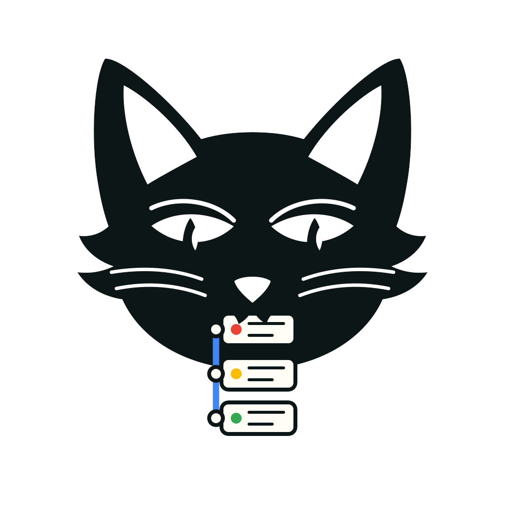

<!--
SPDX-FileCopyrightText: 2026 Blackcat Informatics® Inc. <paudley@blackcatinformatics.ca>
SPDX-License-Identifier: MIT OR Apache-2.0
-->

# GTS — Graph Transport Substrate

[**Read the GTS v2 specification**](docs/GTS-SPEC.md) · [What changes in v2?](DIFFERENCES_IN_v2.md) · [Conformance corpus](vectors/v2/README.md)

GTS carries an RDF dataset and its binary attachments in one appendable file. A museum can send its catalogue,
page scans and signed corrections together. A recipient can compare the catalogue with a copy that was packed
differently, verify the scans independently and identify which commits a trusted key signed.

## Read or implement v2

| To… | Start here |
|---|---|
| Decode a file and interpret its identifiers | [Model and wire](docs/v2/P1.md) and [registry](docs/v2/P2.md) |
| Exchange RDF datasets, including empty named graphs | [RDF content and projection](docs/v2/P3.md) |
| Retrieve and verify attachments | [Blobs](docs/v2/P4.md) |
| Recover a damaged file or verify a signature | [Durability](docs/v2/P5.md) and [signatures](docs/v2/P6.md) |
| Compare two readers or describe a partial result | [Canonical form and reading](docs/v2/P7.md) and [fixture catalogue](docs/v2/FIXTURES.md) |
| Protect private content | [Sealing](docs/v2/P8.md) |
| Convert an existing collection | [Conversion](docs/v2/P9.md) and [migration guide](docs/v2/GUIDE-migration.md) |

The [application guide](docs/v2/GUIDE-applications.md) shows how to choose the checks for a catalogue browser,
a live feed or an archival deposit. The [adoption guide](docs/v2/GUIDE-adoption.md) explains how to report
interoperability results against a particular revision.

## Publication and packages

GTS v2 is published for implementation and review. [Implementer Draft 1](https://github.com/Blackcat-Informatics/gmeow-gts/releases/tag/spec-v2-draft-1)
identifies the first review snapshot. Cite the commit when reporting a finding against the current text.

The released packages predate v2. The repository contains **six interoperable full engines** (Rust, Python, Go, TypeScript,
Smalltalk/Pharo, Kotlin/JVM) for the earlier format. Their test results apply to that release line.
Runtime support policy: Python >=3.13, Node.js >=22.16.0, and Go 1.26.6.

[Contributing](CONTRIBUTING.md) · [Project governance](docs/GTS-GOVERNANCE.md) · [Security reports](SECURITY.md) ·
[Licensing](LICENSING.md) · [Français canadien / 简体中文](docs/i18n/README.md) · [Documentation archive](archive/README.md)
